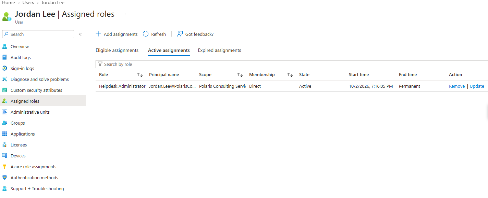
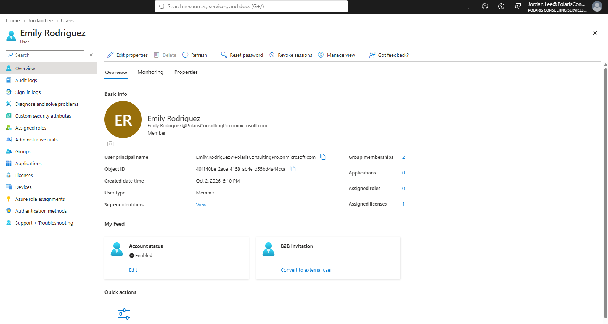
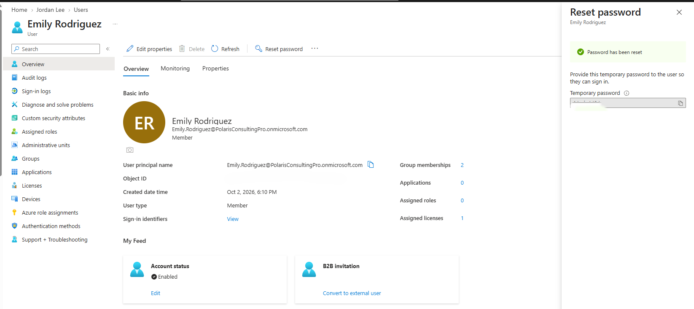
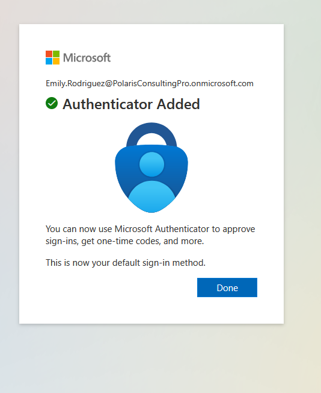
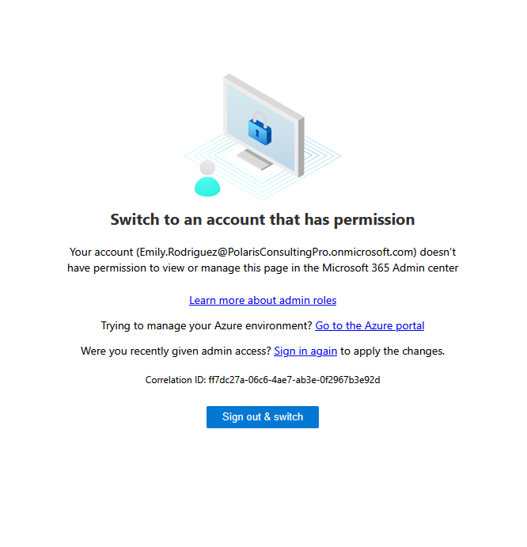

# Lab 02 — Help Desk Identity Support

**Status:** Complete

## Overview

Demonstrates a delegated password-support workflow using the Helpdesk Administrator role rather than Global Administrator.

## Scenario

Emily Rodriguez required password assistance. Jordan Lee was used as the support technician to validate whether routine identity support could be completed with delegated help desk privileges.

## Objectives

- Assign the Helpdesk Administrator role to the support technician.
- Reset a standard user's password through delegated administration.
- Validate the temporary-password and forced-password-change workflow.
- Confirm successful user sign-in after the reset.
- Verify that the supported user still has no administrative portal access.

## Tools and Services Used

- Microsoft Entra admin center
- Microsoft Entra ID
- Microsoft Authenticator
- Microsoft 365 sign-in

## Administrative Workflow

The portal procedures below reflect the navigation used during this lab. Microsoft occasionally changes portal labels or menu placement, but the administrative sequence and validation points remain the same.

### Step 1 — Assign the delegated help desk role

Jordan Lee was assigned the Helpdesk Administrator role at directory scope. No broader role was added for the password-support scenario.

<strong>Portal procedure</strong>

**Navigation:** Microsoft Entra admin center → Identity → Roles & admins → Roles & admins → Helpdesk Administrator

1. Open **Identity → Roles & admins → Roles & admins**.
2. Search for **Helpdesk Administrator**.
3. Open the role and select **Add assignments**.
4. Search for Jordan Lee and select the user.
5. Use directory scope for the assignment.
6. Complete the assignment.
7. Re-open Jordan's assigned roles and confirm that **Helpdesk Administrator** is active and that no broader role was added.

### Step 2 — Review the target user

Emily Rodriguez's user profile was reviewed before the reset to confirm the correct identity and establish the support context.

<strong>Portal procedure</strong>

**Navigation:** Microsoft Entra admin center → Identity → Users → All users → Emily Rodriguez

1. Open **Identity → Users → All users**.
2. Select **Emily Rodriguez**.
3. Review the user principal name, account-enabled state, license status, and assigned roles.
4. Confirm that the correct user is being supported before changing credentials.

### Step 3 — Reset the password

The password reset was completed through Entra. The generated credential itself was redacted from the public evidence.

<strong>Portal procedure</strong>

**Navigation:** Microsoft Entra admin center → Identity → Users → All users → Emily Rodriguez → Reset password

1. Open Emily Rodriguez's user record.
2. Select **Reset password**.
3. Allow Microsoft Entra to generate the temporary credential.
4. Confirm the reset.
5. Provide the temporary credential only through the controlled lab workflow.
6. Do not publish or retain the generated password in portfolio screenshots.

### Step 4 — Complete authentication registration and sign-in

The sign-in flow required Microsoft Authenticator registration. After registration, the user completed the password-change workflow and signed in successfully.

<strong>Portal procedure</strong>

**Navigation:** Microsoft 365 sign-in / Microsoft Authenticator → User sign-in → Security info registration

1. Open a fresh private/incognito browser session.
2. Sign in with Emily Rodriguez's account and the temporary password.
3. Follow the prompt to change the temporary password.
4. When security-information registration is requested, select the Microsoft Authenticator method.
5. On the mobile Authenticator app, add the work or school account and complete the pairing flow.
6. Approve the verification request.
7. Finish sign-in and confirm access to Microsoft 365.

### Step 5 — Verify the privilege boundary

The supported user was able to use Microsoft 365 services but was denied access to the Entra administrative portal, confirming that the reset did not alter her privilege level.

<strong>Portal procedure</strong>

**Navigation:** Microsoft Entra admin center → Attempted admin-center access from the standard user account

1. While signed in as Emily Rodriguez, attempt to open the Microsoft Entra admin center.
2. Confirm that normal Microsoft 365 access works.
3. Confirm that administrative portal access is denied because the user has no administrative role.
4. Return to the administrator session and verify that no role was added to Emily during the password-support workflow.

## Expected Outcome

The support technician can resolve the password issue without Global Administrator access, while the user returns to normal service with no new administrative privilege.

## Validation

- Password reset completed successfully.
- Temporary-password / password-change behavior was validated.
- Microsoft Authenticator registration completed.
- Emily signed in successfully after the reset.
- Emily remained unable to access the Entra admin portal.

## Security Considerations

- Helpdesk Administrator was sufficient for the routine support task.
- Global Administrator was not required for the user-facing reset workflow.
- Authentication secrets and generated passwords are excluded or redacted from the public evidence.

## Common Issues and Troubleshooting

The first Authenticator registration attempt timed out. Refreshing the registration flow resolved the issue without changing the account configuration.

## Key Takeaways

- Routine password support can be delegated without granting broad tenant administration.
- Successful password reset should be validated through the user's next sign-in, not only through an admin confirmation message.
- Authentication registration, password change, and administrative authorization are separate parts of the user-access workflow.
