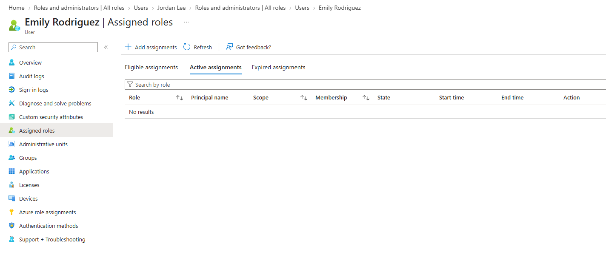
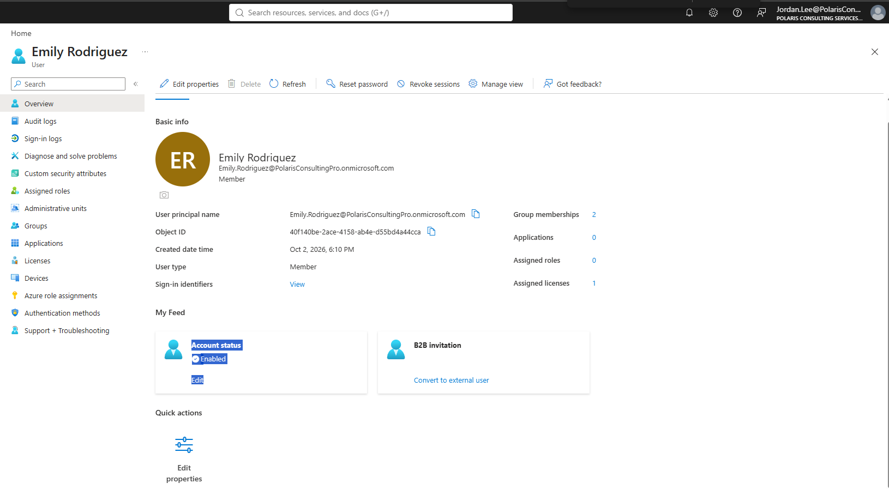
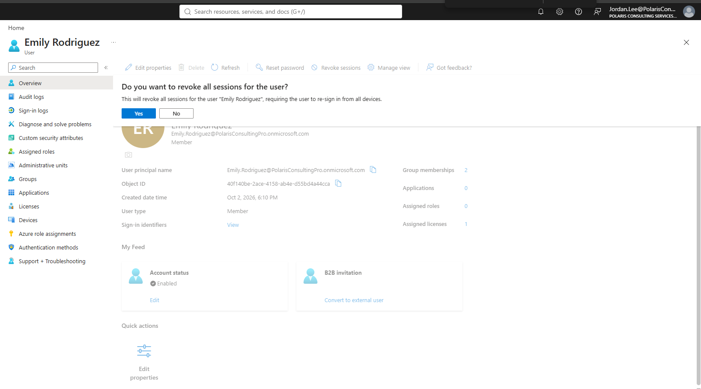
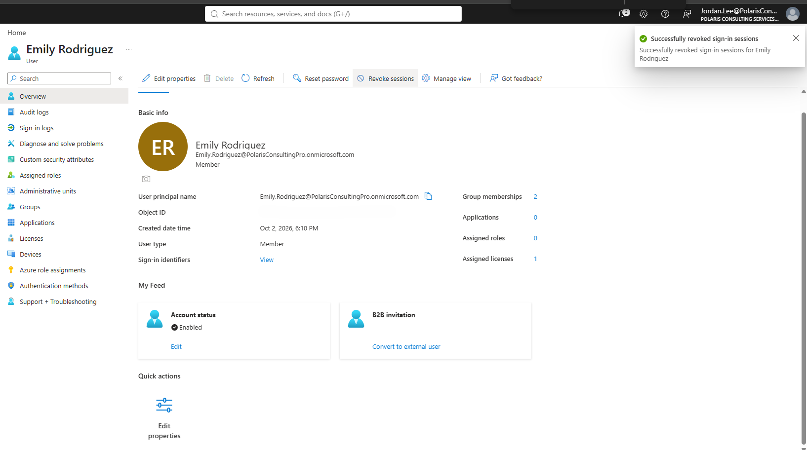
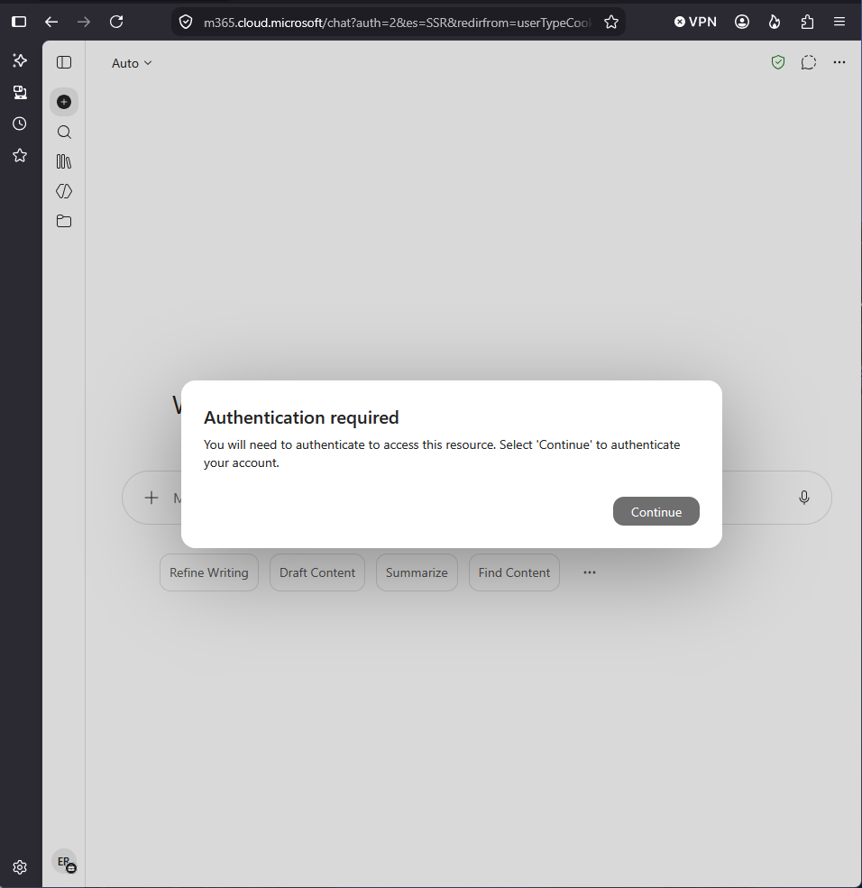
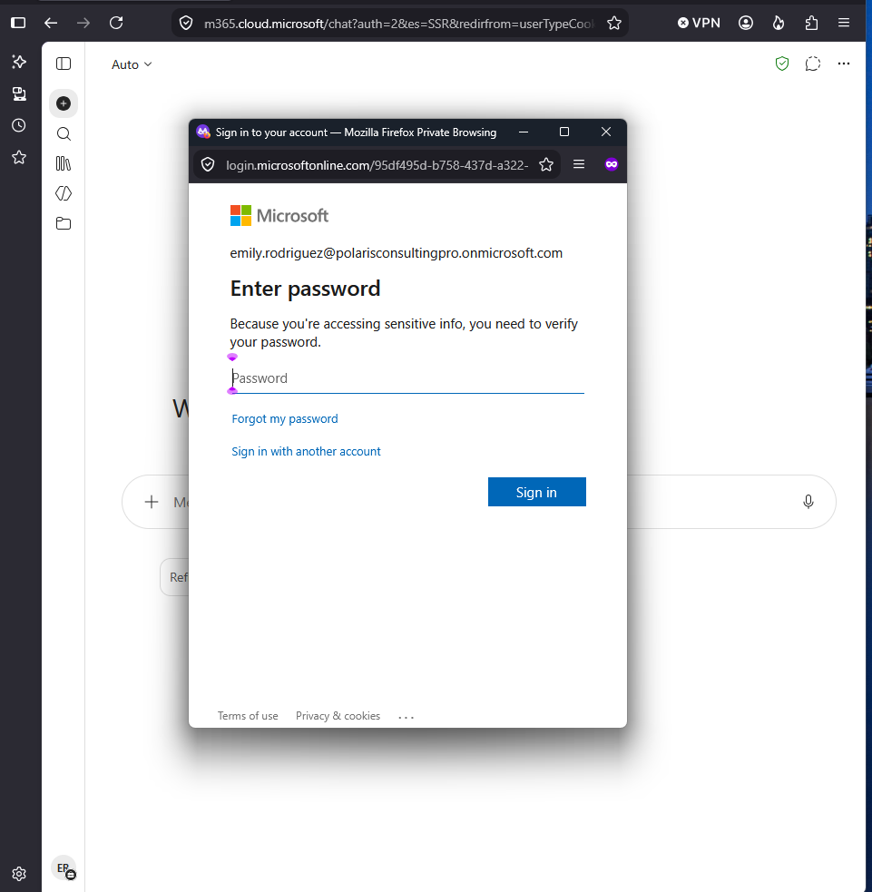

# Lab 03 — Session Management and Help Desk Boundaries

**Status:** Complete

## Overview

Tests session revocation from a delegated help desk role and documents the distinction between terminating active sessions and disabling an account.

## Scenario

A user session needed to be terminated while preserving the account. The same workflow was used to determine whether the Helpdesk Administrator role could also suspend the user completely.

## Objectives

- Confirm the user's account is enabled before testing.
- Revoke active sessions.
- Validate that the next access attempt requires authentication.
- Determine whether Helpdesk Administrator can disable or re-enable the user.
- Document the RBAC boundary without adding unnecessary privilege.

## Tools and Services Used

- Microsoft Entra admin center
- Microsoft Entra ID
- Microsoft 365 sign-in

## Administrative Workflow

The portal procedures below reflect the navigation used during this lab. Microsoft occasionally changes portal labels or menu placement, but the administrative sequence and validation points remain the same.

### Step 1 — Confirm the initial user state

The user profile was reviewed before the test so that session behavior would not be confused with an already disabled account or administrative assignment.

<strong>Portal procedure</strong>

**Navigation:** Microsoft Entra admin center → Identity → Users → All users → Emily Rodriguez → Properties

1. Open Emily Rodriguez's user record.
2. Review **Properties** and confirm **Account enabled = Yes**.
3. Review **Assigned roles** and verify that the user is still non-administrative.
4. Use this state as the baseline before session revocation.

### Step 2 — Initiate session revocation

The revoke-sessions action was initiated for Emily Rodriguez and confirmed through the Entra workflow.

<strong>Portal procedure</strong>

**Navigation:** Microsoft Entra admin center → Identity → Users → All users → Emily Rodriguez → Revoke sessions

1. Open Emily Rodriguez's user record.
2. Select **Revoke sessions**.
3. Read the confirmation prompt.
4. Confirm the revocation request.
5. Wait for the portal to report success before testing the user session.

### Step 3 — Validate successful revocation

Entra reported the session revocation successfully.

<strong>Portal procedure</strong>

**Navigation:** Microsoft Entra admin center → User record → session-revocation confirmation

1. Verify that Microsoft Entra reports the revoke-sessions action as successful.
2. Leave the account itself enabled.
3. Do not change the password or account-enabled state during this part of the test.

### Step 4 — Test the next sign-in

A fresh access attempt required reauthentication, demonstrating that the active session had been invalidated.

<strong>Portal procedure</strong>

**Navigation:** Microsoft 365 sign-in → Existing user session → new authentication challenge

1. Return to the user's existing Microsoft 365 session or open a protected Microsoft 365 resource.
2. Confirm that the existing session is no longer accepted.
3. Complete the new authentication prompt.
4. Verify that the user can sign in again because the account remains enabled.
5. Compare the result with the later account-disable lab, where sign-in is intentionally blocked.

## Expected Outcome

Active sessions are terminated and the user must authenticate again, while the account itself remains enabled.

## Validation

- Session revocation completed successfully.
- A new authentication prompt appeared after revocation.
- The user could sign in again because the account remained enabled.
- Helpdesk Administrator could not modify the account-enabled state.

## Security Considerations

- No extra role was granted simply to force the account-disable portion of the scenario.
- The existing Helpdesk Administrator boundary was documented as part of the result.

## Common Issues and Troubleshooting

The important distinction was functional rather than a portal error: session revocation removed existing sessions but did not block future sign-ins. The account-enabled control remained outside the Helpdesk Administrator permission boundary.

## Key Takeaways

- Session revocation and account suspension are different controls.
- A technician can terminate active access without necessarily having authority to disable the identity.
- Permission boundaries are part of the operational result and should not be bypassed merely to complete a checklist.
