# Lab 12 — Account Lifecycle and Least-Privilege Role Comparison

**Status:** Complete

## Overview

Completes the earlier account-suspension scenario by comparing Helpdesk Administrator and User Administrator permissions and removing the temporary privilege after use.

## Scenario

The earlier session-management lab proved that Helpdesk Administrator could revoke sessions but could not disable the user. The follow-up lab used the narrower role required for the missing lifecycle action.

## Objectives

- Establish the initial Helpdesk Administrator baseline.
- Temporarily assign User Administrator.
- Disable a standard user account.
- Revoke sessions and confirm fresh sign-in is blocked.
- Re-enable the account and validate service restoration.
- Remove the temporary User Administrator assignment.

## Tools and Services Used

- Microsoft Entra admin center
- Microsoft Entra roles
- Microsoft 365 sign-in

## Administrative Workflow

The portal procedures below reflect the navigation used during this lab. Microsoft occasionally changes portal labels or menu placement, but the administrative sequence and validation points remain the same.

### Step 1 — Confirm the initial role and user state

Jordan Lee began with Helpdesk Administrator only, and Emily Rodriguez was enabled as a normal licensed user.

<strong>Portal procedure</strong>

**Navigation:** Microsoft Entra admin center → Identity → Users / Roles & admins

1. Open Jordan Lee and review **Assigned roles**.
2. Confirm that Helpdesk Administrator is the starting administrative role.
3. Open Emily Rodriguez and review **Properties**.
4. Confirm **Account enabled = Yes** and that the user has no administrative role.

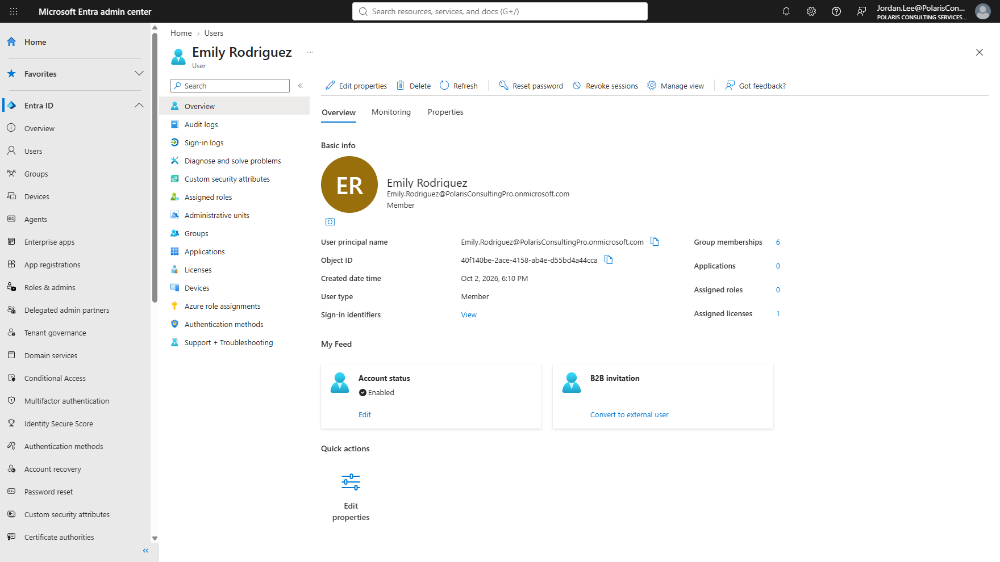

### Step 2 — Temporarily assign User Administrator

User Administrator was added only for the lifecycle operation that Helpdesk Administrator could not perform.

<strong>Portal procedure</strong>

**Navigation:** Microsoft Entra admin center → Identity → Roles & admins → User Administrator → Add assignments

1. Open **Identity → Roles & admins**.
2. Search for **User Administrator**.
3. Open the role and select **Add assignments**.
4. Add Jordan Lee at directory scope.
5. Confirm the assignment is active before attempting the account-state change.

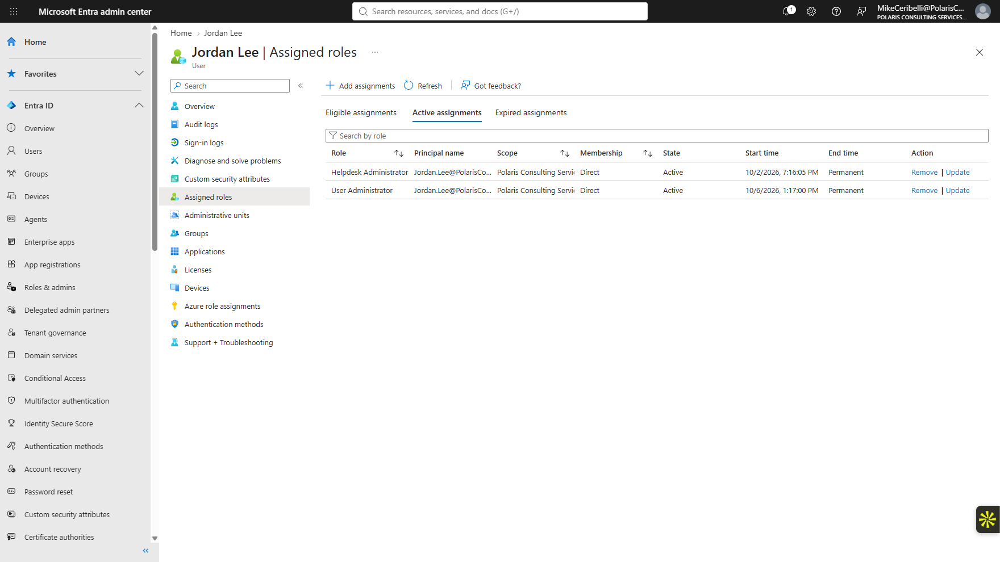

### Step 3 — Disable the user account

Emily's account-enabled state was changed to `No` and the action was confirmed.

<strong>Portal procedure</strong>

**Navigation:** Microsoft Entra admin center → Identity → Users → Emily Rodriguez → Properties

1. Open Emily Rodriguez.
2. Open **Properties** and select **Edit properties**.
3. Change **Account enabled** from **Yes** to **No**.
4. Save the change.
5. Return to the user overview and confirm the account is disabled.
6. Revoke active sessions so the disabled state is reflected on fresh access attempts.

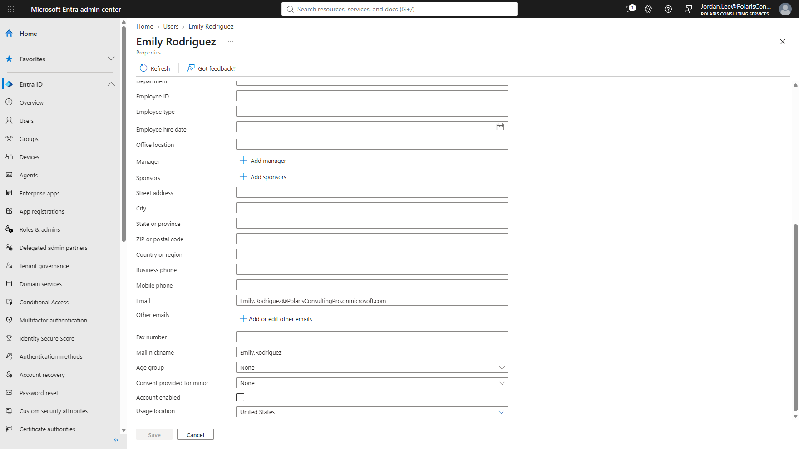

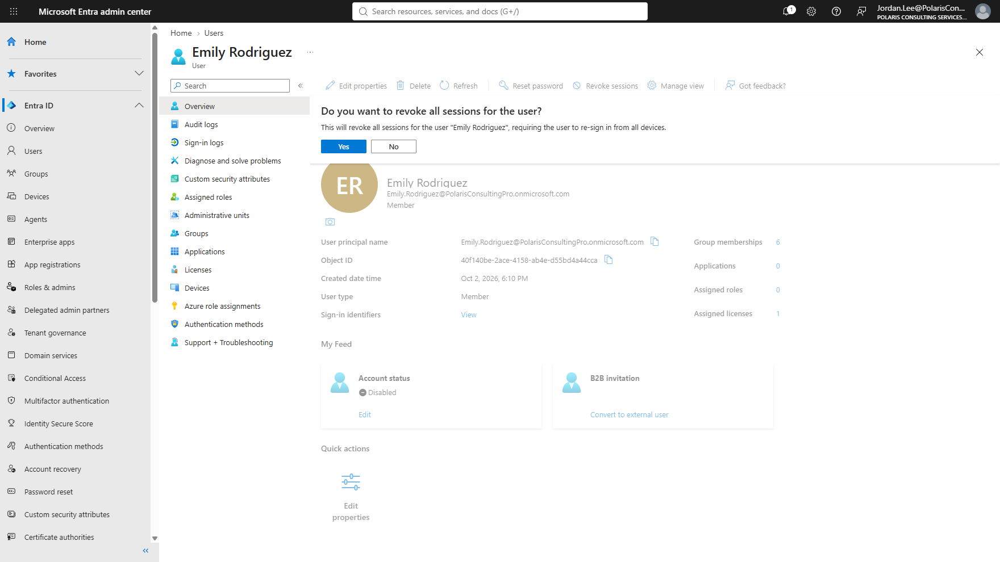

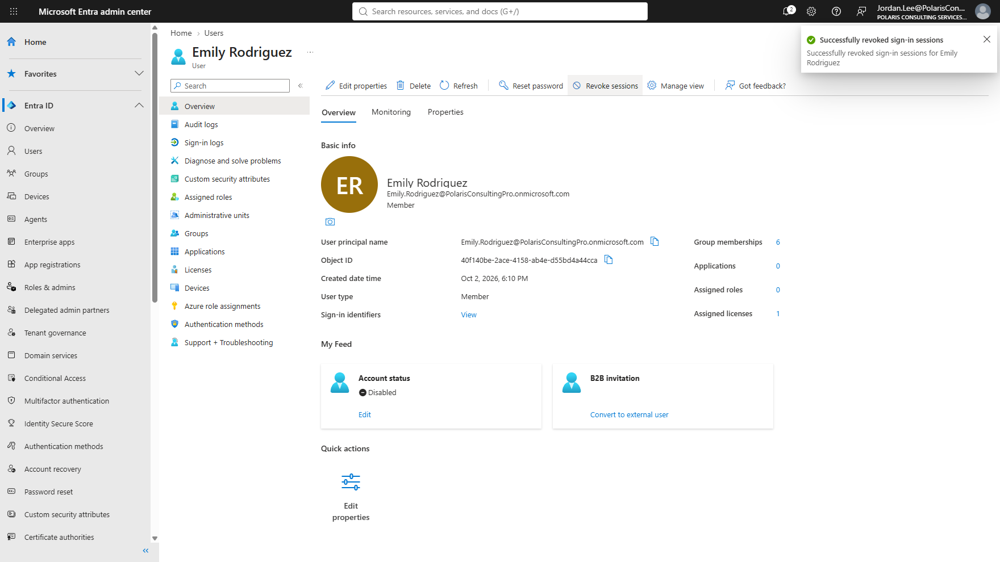

### Step 4 — Validate blocked sign-in

A fresh authentication attempt was denied while the account was disabled.

<strong>Portal procedure</strong>

**Navigation:** Microsoft 365 sign-in → Fresh private/incognito sign-in

1. Open a new private/incognito browser window.
2. Attempt to sign in as Emily Rodriguez.
3. Confirm the account is blocked/locked while the account-enabled state is `No`.
4. Do not alter the password or license during the suspension test.

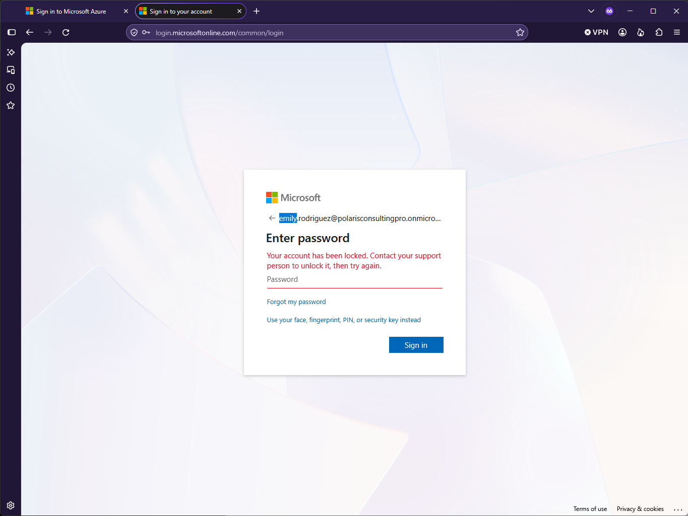

### Step 5 — Restore the user

The account was re-enabled and a fresh sign-in confirmed service restoration.

<strong>Portal procedure</strong>

**Navigation:** Microsoft Entra admin center / Microsoft 365 sign-in → User Properties → Account enabled = Yes

1. Return to Emily Rodriguez's **Properties**.
2. Change **Account enabled** back to **Yes**.
3. Save the change.
4. Open a fresh user sign-in session.
5. Confirm that Microsoft 365 access works again with the existing account and license.

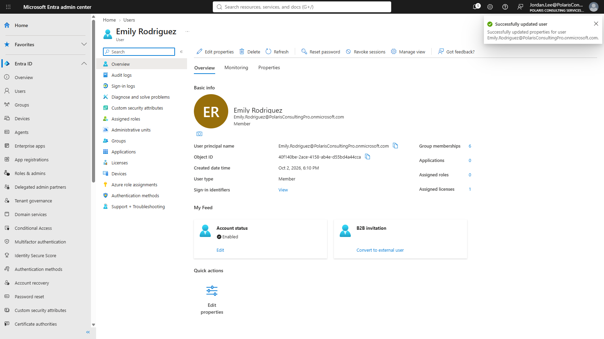

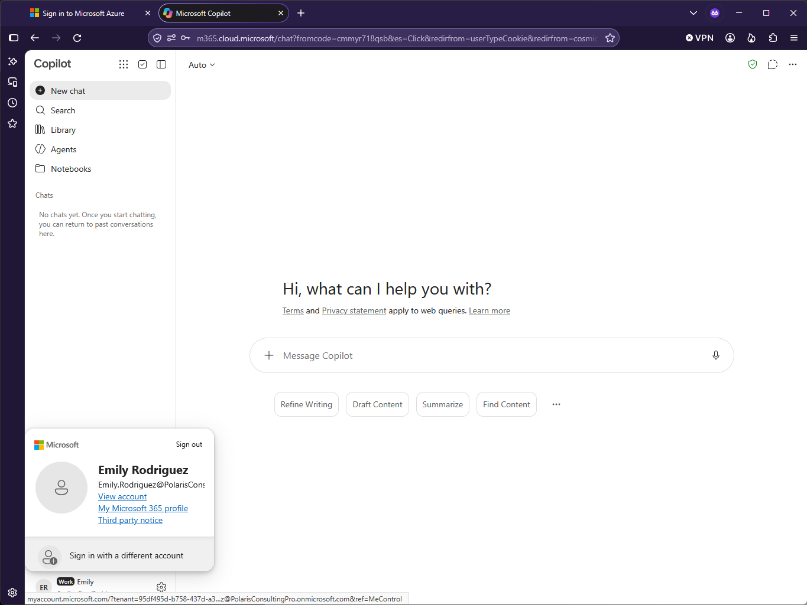

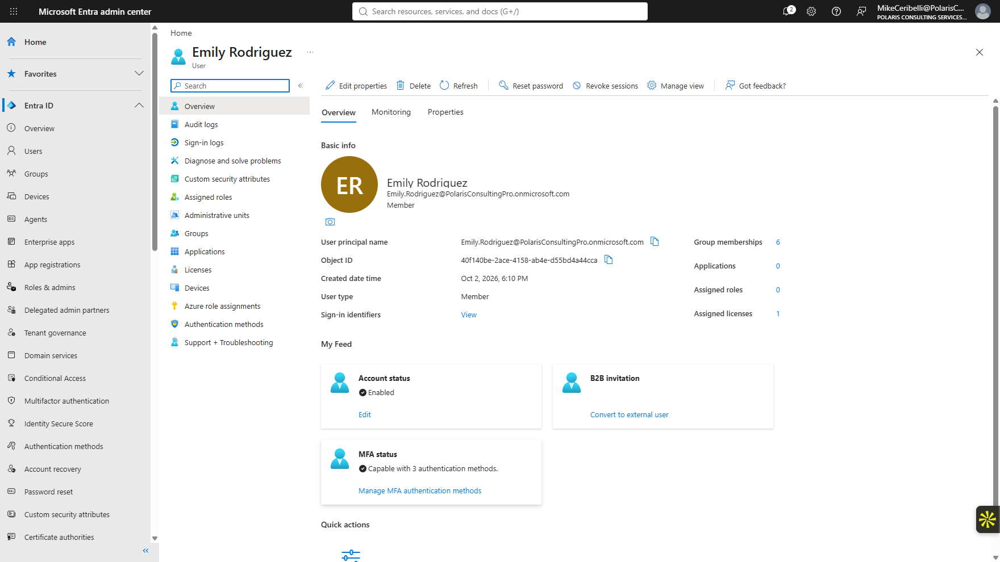

### Step 6 — Remove the temporary privilege

The User Administrator assignment was removed and Jordan returned to Helpdesk Administrator only.

<strong>Portal procedure</strong>

**Navigation:** Microsoft Entra admin center → Identity → Roles & admins → User Administrator → Assignments

1. Open the **User Administrator** role.
2. Locate Jordan Lee's temporary assignment.
3. Remove the assignment.
4. Return to Jordan's **Assigned roles**.
5. Confirm that the final administrative state is Helpdesk Administrator only.

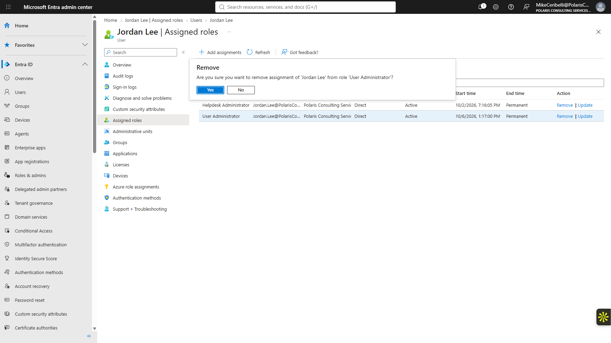

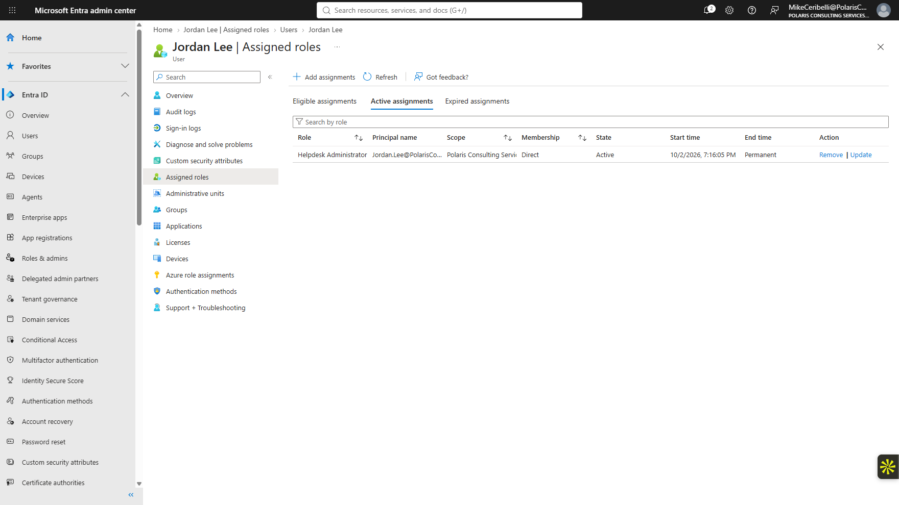

## Expected Outcome

The account can be suspended and restored using the appropriate delegated role, and the temporary role is removed immediately afterward.

## Validation

- Helpdesk Administrator baseline confirmed.
- Temporary User Administrator assignment added.
- Account disabled successfully.
- Fresh sign-in blocked while disabled.
- Account re-enabled successfully.
- Fresh sign-in restored.
- Temporary User Administrator assignment removed.

## Security Considerations

- Global Administrator was not used for the lifecycle action.
- The additional role existed only for the task that required it.
- The final technician state returned to Helpdesk Administrator only.

## Key Takeaways

- RBAC design should match the specific administrative action rather than defaulting to the broadest role.
- Disabling an account and revoking sessions are complementary but distinct controls.
- Temporary elevation should include a cleanup step that returns the operator to the intended baseline.
