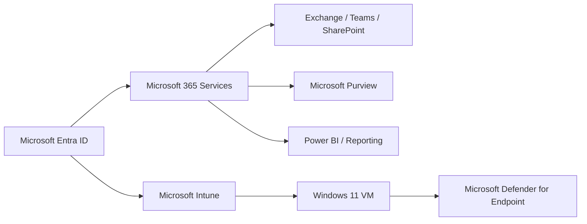

# IT Help Desk & Support Portfolio

Microsoft 365 support operations, identity troubleshooting, messaging, collaboration, endpoint support, and service-desk analytics.

## Portfolio Overview

This repository documents the Microsoft 365 environment for **Polaris Consulting Services** through a series of operational administration and support projects. The emphasis is on configuration that can be validated through user behavior, service telemetry, policy results, message trace, sign-in logs, endpoint reporting, and other native Microsoft 365 evidence.

The tenant users, service-desk records, payment-card test values, and business scenarios were created specifically for the lab environment.

## Environment at a Glance

- Microsoft 365 E5 / Office 365 E5 lab tenant
- Microsoft Entra ID
- Exchange Online
- Microsoft Teams
- SharePoint Online
- Microsoft Intune
- Microsoft Defender
- Microsoft Purview
- OneDrive for Business
- Power BI
- Windows 11 Pro VMware endpoint

## Projects

| Lab | Project | Primary focus |
|---|---|---|
| 01 | [Tenant Foundation](Lab-01-Tenant-Foundation/README.md) | Identity, licensing, groups |
| 02 | [Help Desk Identity Support](Lab-02-Help-Desk-Identity-Support/README.md) | Password support, delegated admin |
| 03 | [Session Management and Help Desk Boundaries](Lab-03-Session-Management-and-Help-Desk-Boundaries/README.md) | Session revocation, RBAC boundary |
| 04 | [Exchange Online Administration](Lab-04-Exchange-Online-Administration/README.md) | Mailboxes, delegation, aliases, trace |
| 05 | [Microsoft Teams Administration](Lab-05-Microsoft-Teams-Administration/README.md) | Teams ownership, channels, access |
| 06 | [SharePoint and Teams Integration](Lab-06-SharePoint-and-Teams-Integration/README.md) | SharePoint permissions, Teams files |
| 11 | [Intune Windows Endpoint Validation](Lab-11-Intune-Windows-Endpoint-Validation/README.md) | Windows enrollment, compliance |
| 12 | [Account Lifecycle and Least-Privilege Role Comparison](Lab-12-Account-Lifecycle-and-Least-Privilege-Role-Comparison/README.md) | Account suspension, role comparison |
| 14 | [OneDrive and SharePoint Local Sync](Lab-14-OneDrive-and-SharePoint-Local-Sync/README.md) | OneDrive / SharePoint sync |
| 15 | [Power BI Service Desk Analytics](Lab-15-Power-BI-Service-Desk-Analytics/README.md) | Power BI service-desk analytics |

## Core Competencies

- Microsoft Entra user support and RBAC
- Password reset and session management
- Exchange Online mailboxes, aliases, groups, and trace
- Teams and SharePoint user-access troubleshooting
- Intune-managed Windows support
- OneDrive / SharePoint synchronization
- Power BI service-desk reporting

## Administrative Approach

The projects are documented as progressive operational workflows rather than isolated configuration screenshots. Each lab records the scenario, objectives, tools, administrative steps, validation evidence, relevant security considerations, troubleshooting, and final operational takeaways.

Where a Microsoft service remained in report-only, simulation, propagation, or asynchronous processing state, the documented result reflects the actual state of the environment.

## Environment Flow



## Repository Structure

```text
IT-Help-Desk-Portfolio/
├── README.md
├── Lab-01-Tenant-Foundation/
│   ├── README.md
│   └── screenshots/
├── Lab-02-Help-Desk-Identity-Support/
│   ├── README.md
│   └── screenshots/
├── Lab-03-Session-Management-and-Help-Desk-Boundaries/
│   ├── README.md
│   └── screenshots/
├── Lab-04-Exchange-Online-Administration/
│   ├── README.md
│   └── screenshots/
├── Lab-05-Microsoft-Teams-Administration/
│   ├── README.md
│   └── screenshots/
├── Lab-06-SharePoint-and-Teams-Integration/
│   ├── README.md
│   └── screenshots/
├── Lab-11-Intune-Windows-Endpoint-Validation/
│   ├── README.md
│   └── screenshots/
├── Lab-12-Account-Lifecycle-and-Least-Privilege-Role-Comparison/
│   ├── README.md
│   └── screenshots/
├── Lab-14-OneDrive-and-SharePoint-Local-Sync/
│   ├── README.md
│   └── screenshots/
├── Lab-15-Power-BI-Service-Desk-Analytics/
│   ├── README.md
│   └── screenshots/
```

## Evidence

Screenshots are placed beside the workflow step they support. Public copies were selected from the lab evidence pool, with sensitive identifiers removed or excluded where necessary.
